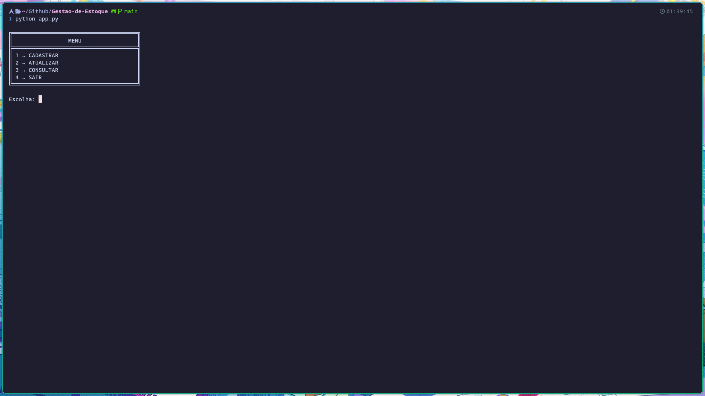
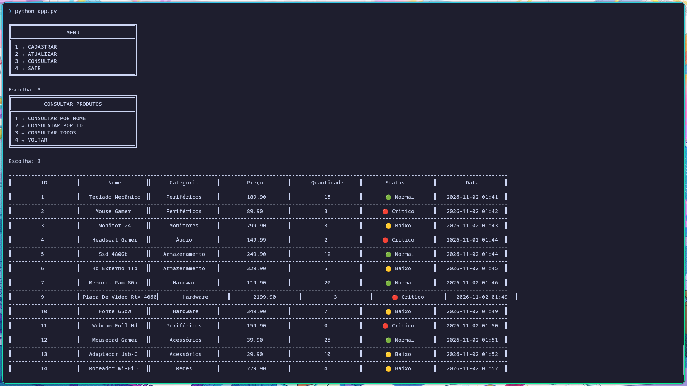
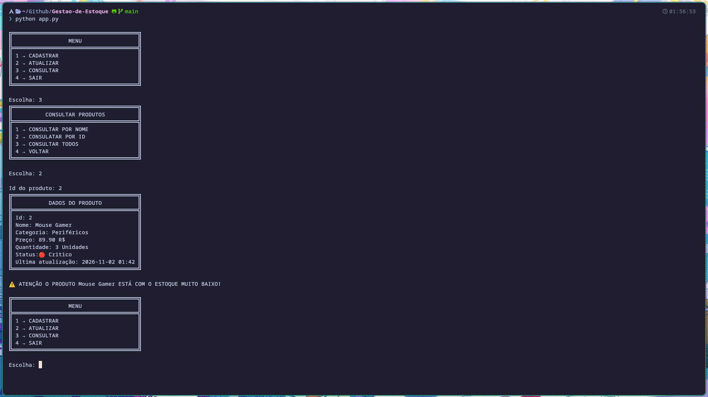
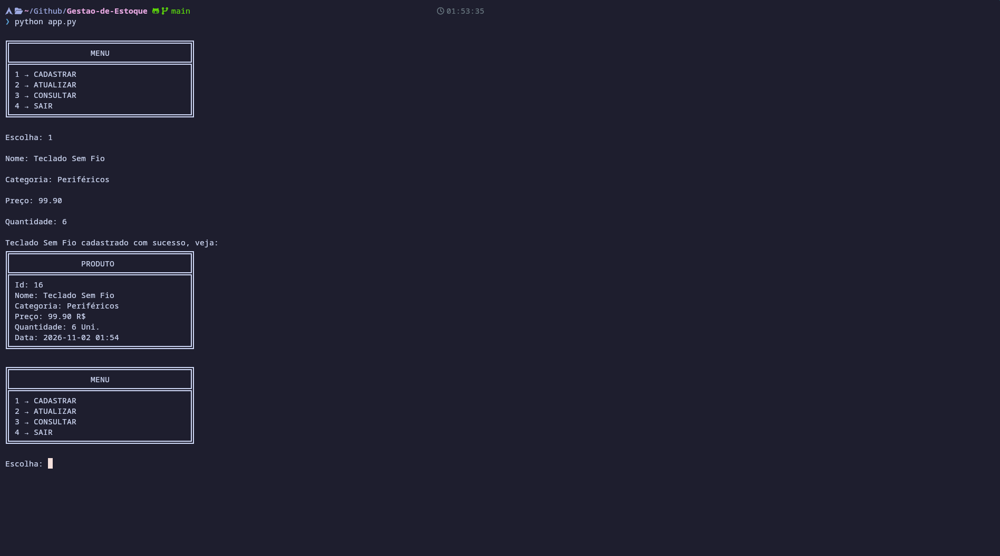
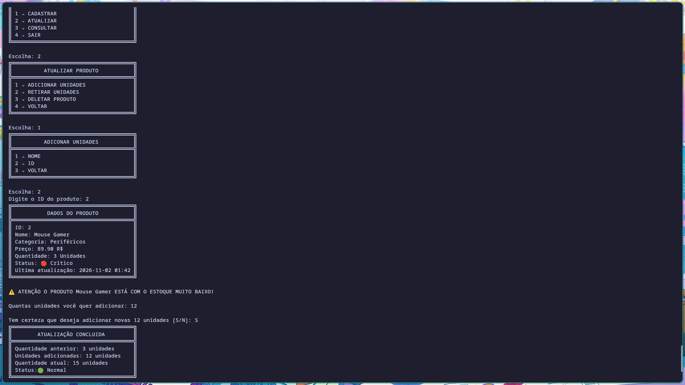

<div align="center">

# Gestão de Estoque


**Sistema de gerenciamento de estoque desenvolvido em Python e SQLite, executado pelo terminal.**

</div>

## Sobre o projeto

O projeto foi desenvolvido com o objetivo de praticar lógica de programação, manipulação de banco de dados e operações CRUD utilizando Python.

A aplicação permite gerenciar produtos de um estoque, mantendo suas informações organizadas e facilitando o controle de quantidades e consultas.

## Funcionalidades

O sistema oferece as seguintes operações:

- Cadastro de produtos;
- Consulta de produtos por ID ou nome;
- Listagem de todos os produtos;
- Atualização de quantidades em estoque;
- Adição e remoção de unidades;
- Exclusão de produtos;
- Identificação automática do nível de estoque;
- Registro automático de data;
- Validação de entradas e tratamento de erros.

 ## Demonstrações

 

<details> 

<summary> Outros testes</summary>
<summary> Listagem</summary>



<summary> Estoque</summary>



<summary> Cadastro</summary>



<summary> Atualização</summary>


</details>
 

### Níveis de estoque

O sistema identifica a situação dos produtos de acordo com a quantidade disponível:

| Status | Quantidade |
|:---:|:---:|
| 🔴 Crítico | Até 3 unidades |
| 🟡 Baixo | Até 10 unidades |
| 🟢 Normal | Acima de 10 unidades |

## Tecnologias utilizadas
- [Python](https://www.python.org/downloads/) : desenvolvimento da aplicação e implementação das funcionalidades.
- [SQLite3](https://sqlite.org/): armazenamento e gerenciamento dos dados.
- [Datetime](https://docs.python.org/3/library/datetime.html#module-datetime): registro e manipulação de datas.

## Requisitos

Para executar o projeto, é necessário possuir:

- [Python](https://www.python.org/downloads/) instalado;
- [Git](https://git-scm.com/install/) instalado;
- Terminal ou editor de código de sua preferência.

Não é necessário instalar bibliotecas externas ou configurar um servidor de banco de dados.

## Como executar

Clone o repositório:

```bash
git clone https://github.com/Danyel-xp/Gestao-de-Estoque.git
```

Entre no diretório:

```bash
cd Gestao-de-Estoque
```

Execute a aplicação:

```bash
python app.py
```

O banco de dados SQLite será utilizado localmente para armazenar as informações dos produtos.

## Estrutura do projeto

```text
Gestao-de-Estoque/
│
├── assets/
│   ├── menu.png
│   ├── listagem.png
│   ├── cadastro.png
│   ├── estoque.png
│   └── atualizacao.png
│
├── app.py
├── db.py
├── estoque.db
└── README.md
```

## Colaboradores

- **Daniel Rodrigues** — Desenvolvimento principal e integração com SQLite.

  GitHub: [@Danyel-xp](https://github.com/Danyel-xp)

- **Nicolas Ribeiro** — Auxílio no desenvolvimento e testes.

  GitHub: [@NicolasWebMaster](https://github.com/NicolasWebMaster)

- **Estevão** — Auxílio na organização, validações e testes.

  GitHub: [@Estevao-exe](https://github.com/Estevao-exe)
